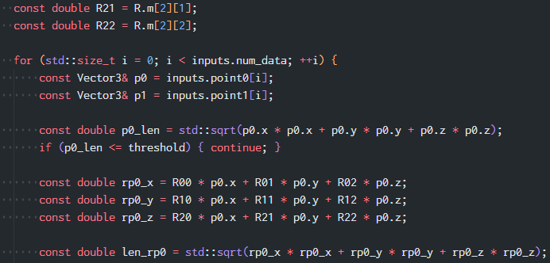
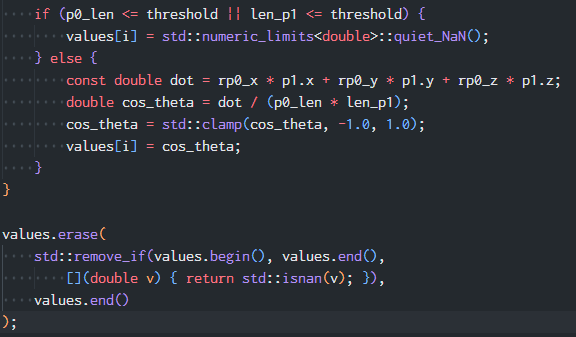
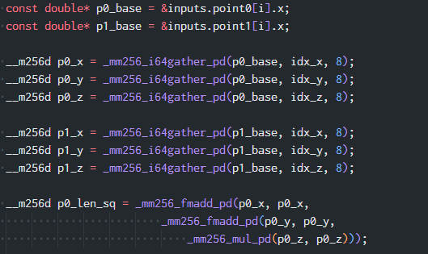

# vectorize@apex-marketplace package demo

`vectorize` スキルシリーズのデモ用プロジェクトです。

> **ビルド手順は [`demo/README.md`](demo/README.md) を参照してください。** この README はデモの
> ウォークスルー（解答）を含むため、エージェントには読まれないようにしてください。エージェントは
> `demo/` フォルダから起動し、`demo/README.md` を読んでビルドし、目の前のコードから作業を進めます。
> 起動時に **ルートの README および `docs/` は読まないこと**を instruction で明示してください。

## Installation

```sh
git clone <apex-examples-repo-url>
cd apex-examples/vectorize
```

APEX 配布物に含まれる `apm` CLI でマーケットプレイスを登録し、スキルを取り込みます。
マーケットプレイスの URL と `apm` の導入手順は APEX 配布物の案内に従ってください。

```sh
apm marketplace add https://__APEX_HOST__:4430/apex/marketplace.git
```

作業ブランチを切って、スキルを読み込みましょう。

```sh
git checkout -b demo-trial1
# スキルをインストール (使用するツールに応じてtarget指定してください)
apm install --dev --target opencode vectorize@apex-marketplace#vectorize-v0.1.0
# 既に `.apex-work/vectorize` がある場合は削除して作業開始してください
rm -rf .apex-work/vectorize
```

opencode/claudeを立ち上げて作業を始めましょう。
なお、各スキルは前段のスキルが完了している状態であれば、別セッションで続きの作業を行っても構いません。

## Usage

vectorize スキルを使ってこのデモリポジトリを高速化します。

このデモでは `demo/src/evaluate_pose_alignment.cpp` の `EvaluatePoseAlignmentValues` をAVX2向けに高速化する作業を行います。

### エージェントの起動方法

`demo/` フォルダに入って opencode / Claude Code を起動し、ルート README と `docs/` を読まないよう指示します:

```
/vectorize-setup demo/src/evaluate_pose_alignment.cpp のEvaluatePoseAlignmentValues を高速化したい
instruction として ./ フォルダの外の README および docs は読まないこと。
```

> ウォークスルー（ルート README / `docs/`）は人間用（GitHub / serve ドキュメント）であって、
> エージェントは読まない。エージェントは目の前のコードから本当に作業する。

## vectorize スキルシリーズについて

以下のスキルから構成されています:

- `/target-setup` (vectorizeの依存スキル)
  - 対象プログラムのビルド・実行環境を構築するスキル
- `/vectorize-setup`
  - 最適化対象や開発方法についてユーザからヒヤリングするスキル
  - ※ ループレベルで対象をきちんと指定することが望ましい
    - 後はループをSIMD化したいという状態までもっていってからこのスキル群を使うとよい。
- `/vectorize-do-primitive`
  - 関数呼び出しを手動をインライン展開するなど基本的なSIMDの前準備的コード変換を行う
- `/vectorize-review-refinement`
  - NEON化したいコードへ変換する施策を立案するスキル
  - ※生成された施策に関してはユーザが確認した方が望ましい
    - 不正な仕様変更の防止や筋の悪いアプローチを除外する等、高度な判断が必要
- `/vectorize-do-refinement`
  - review-refinement で生成された施策を実施するスキル
- `/vectorize-do-simd`
  - 対象コードを単純にSIMD化するスキル


### Step1. /target-setup

対象プログラムのビルド・実行環境を構築します。

```
/target-setup
```

Agentからビルド手順や実行手順について質問されるので、Agentと協議して必要な情報をまとめてください。
この過程で `apex-target-build.sh` `apex-target-run.sh` というスクリプトをAgentが作ります。これはAgentが対象のプログラムのビルドや実行で使うスクリプトです。複雑な環境の場合はユーザが作成を支援する必要があるでしょう。

このデモリポジトリでの指示の仕方Tipsを挙げておきます。

- ビルド・実行手順は`demo/README.md`に記載されているので自動的に参照しますが、読まない場合は明示的に指示してください。

最終的に以下のファイルが適切に作成されているか確認してください。

- `.apex-work/apex-target-build.sh`
- `.apex-work/apex-target-run.sh`


### Step2. /vectorize-setup

ビルド・実行スクリプトは Step1 の `/target-setup` で作成済みであることを前提とします。

スキル群を順番に実行します。`/vectorize-setup` でAgentの開発環境を整えてあげましょう。

```
/vectorize-setup demo/src/evaluate_pose_alignment.cpp のEvaluatePoseAlignmentValues を高速化したい
```

Agentから実行方法や最適化方針について質問されるので、Agentと協議して必要な情報をまとめてください。

このデモリポジトリでの指示の仕方Tipsを挙げておきます。

- 妥当性評価で小数点誤差は許容させておくと良い
- 処理時間は手元のPCで動かすとジッタが多いはずなので複数回実行させるように指導する

最終的に以下のファイルが適切に作成されているか確認してください。
※この他に後々の作業で使うためのファイルが展開されますが、それらの確認は不要です。

- `.apex-work/vectorize/task-description.md`


### Step3. /vectorize-do-primitive

このスキルでは対象コードをintやdoubleのようなプリミティブ型だけを使ったシンプルな実装に書き換え、コード整理を行います。

単にスキルコールすれば動作します。

```txt
/vectorize-do-primitive
```

自律的にコードの修正が始まりますので、見届けたり放置したりしてください。

実行例:行列クラスが消えてこのように書き換えられました。(Vector3が展開されていないのはご愛嬌ですね)




### Step4. /vectorize-review-refinement and /vectorize-do-refinement

review-refinement をスキルコールします。

```
/vectorize-review-refinement
```

AIがSIMD化するのに都合が良くなる仕様にするための修正案を考えます。生成完了すると
`.apex-work/vectorize/refinement-propose` にAIが考えた案が出力されます。

do-primitive では単純な変換処理を意図しているため自律的に変換を行いますが、
`refinement` で行う修正はプログラムの要件によっては不適切な修正の可能性があります。
そのため、修正案を確認して実行して良いか確認することをお勧めします。

不適切であればファイルを削除・修正をしてください。手動でファイルを追記することも可能です。書式は生成されたファイルに寄せると安定すると思います。

確認が終われば、do-refinement で修正を始めます。

```
/vectorize-do-refinement
```

実行例: push_backが消えました。(NaNを入れて後から除去するという手順が良いのかは議論の余地がありますね)




### Step5. /vectorize-do-simd

ここまでSIMD化がしやすいコードに置き換わっているはずです。

ここでスキルコールすれば、実際のSIMD処理が始まります。

```
/vectorize-do-simd
```

実行例: SIMD化してくれました。 (gather命令のloadが気になりますが、AoS vs SoAは仕様的にどちらが望ましいのか要検討ですね)




作業結果サマリは `.apex-work/vectorize/task/result.md` にも記載があります。
確認してください。

実行例: 処理時間の変化

| ステージ                  |             | 改善率 |
|---------------------------|------------:|-------:|
| ベースライン (最適化前)   | 0.896453 ms |      - |
| Primitive + Refinement 後 | 0.493348 ms |  45.0% |
| SIMD (AVX2) 後            | 0.403337 ms |  55.0% |

## まとめ

vectorize スキルシリーズを使って、SIMD化する例を作成しました。

この後は、この実装が適切であるかレビューしたり、さらに改善が出来ないのか検討を深めるのが良いと思います。

このスキルシリーズは単純なSIMD化をサポートするものです。
プログラム全体を見渡して戦略を立てるのは人間か（または別のAgent）の仕事です。
処理フローは整理して、後はSIMD化するだけどSIMD化実装を書くのは面倒ってなった時に是非このスキルを使ってみてください。
